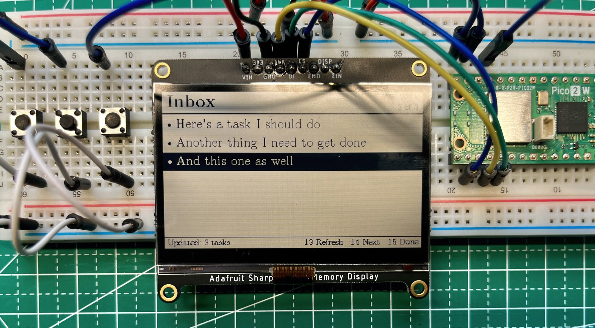
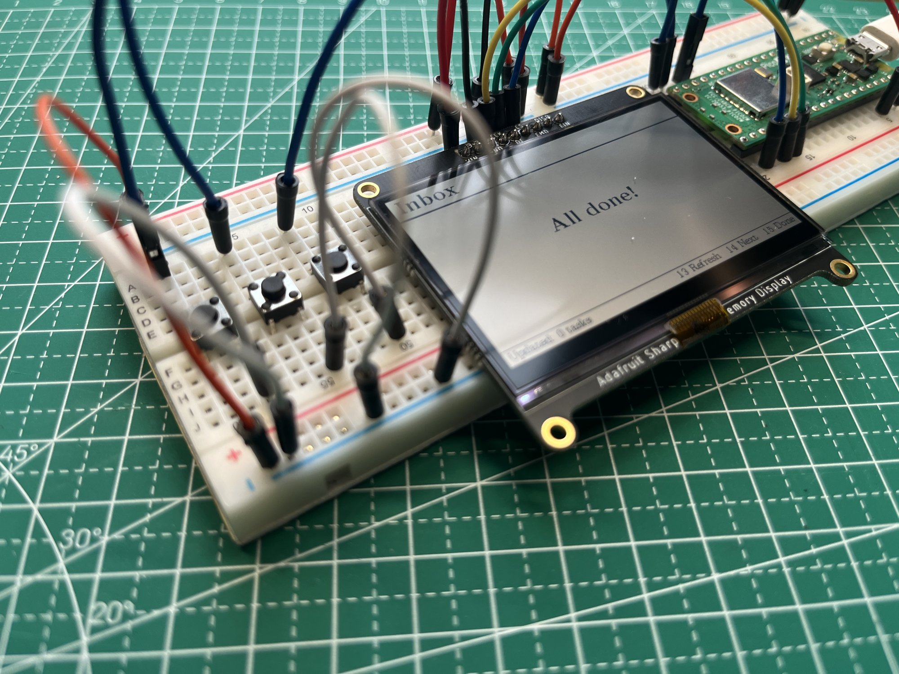

# digital-to-do

A to-do list display that fetches tasks from the Todoist API and shows them on a Sharp Memory Display, with three buttons to refresh, scroll and tick tasks off. Programmed in MicroPython on a Raspberry Pi Pico 2 W.

## How to run

1. Flash MicroPython onto the Pico 2 W (the `RPI_PICO2_W` build already includes the `requests` and `network` modules this uses).
2. Copy `config_example.py` to `config.py` and fill in your Wi-Fi name, Wi-Fi password and Todoist API token (Todoist > Settings > Integrations > Developer).
3. Set the circuit up physically, making sure the right pins are correctly placed (see the pin layout below).
4. Copy every `.py` file in the top folder onto the Pico, e.g. with `mpremote`:
   ```
   mpremote cp *.py :
   ```
5. Reset the Pico. `main.py` runs automatically on boot, connects to Wi-Fi and shows your Todoist Inbox. It re-fetches the list every minute.

> [!TIP]
> Run `mpremote run test_display.py` first to check the screen is wired correctly before adding Wi-Fi and Todoist.

### Buttons

| Button | Action |
| --- | --- |
| GP13 | Refresh the list from Todoist |
| GP14 | Move the highlight down to the next task (wraps back to the top) |
| GP15 | Mark the highlighted task as complete in Todoist |

Each button press is also printed in the terminal, which helps when debugging.

## Equipment
- Raspberry Pi Pico 2 W
> [!NOTE]
> Any microcontroller with network access and MicroPython support should be acceptable, but the pin numbers will need changing.
- Adafruit Sharp Memory Display 2.7" 400x240 Monochrome
> [!NOTE]
> The screen only needs power when it changes, and the picture stays on it without refreshing. The driver for it is `sharp_memory_display.py` in this repository.
- 3 push buttons
- Breadboard and pin-to-pin wires
> [!WARNING]
> Many full-size breadboards have power rails that are split in the middle. If the screen stays blank or the buttons do nothing, check that both halves of the rails are joined. This is a problem I encountered and spent way too long troubleshooting. 
- A Todoist account and API token.

## Pin Layout

| Display breakout | Pico 2 W |
| --- | --- |
| VIN | 3V3(OUT), physical pin 36 |
| GND | GND, physical pin 38 |
| CLK | GP18 (SPI0 SCK), physical pin 24 |
| DI | GP19 (SPI0 TX/MOSI), physical pin 25 |
| CS | GP17, physical pin 22 |

The three buttons connect GP13, GP14 and GP15 to GND. The Pico's internal pull-up resistors are used, so no extra resistors are needed.

> [!NOTE]
> GP numbers are different to the physical pin numbers. The display's CS pin is active HIGH, which is the opposite of most SPI devices, and the driver handles this.

## Fonts

The text uses CMU Serif, converted into bitmap fonts (`font_header.py`, `font_body.py`, `font_small.py`) by `tools/make_fonts.py`. To change the font or size, edit `FONTS` in that script, run it on your computer with `python3 tools/make_fonts.py` (needs Pillow), and copy the new `font_*.py` files onto the Pico.

## Photographs


Picture 1: Full project with the Pico 2 W, Sharp Memory Display and three buttons.


Picture 2: The Todoist Inbox on the display with the third task highlighted.


Picture 3: Left side view.


Picture 4: Right side view.

## Footnote

> [!WARNING]
> This repository is not planned on being maintained. It is just a place to upload my code. If there are any questions regarding code, setup, etc, I am happy to answer them. Otherwise, there will be few changes to this repository.
